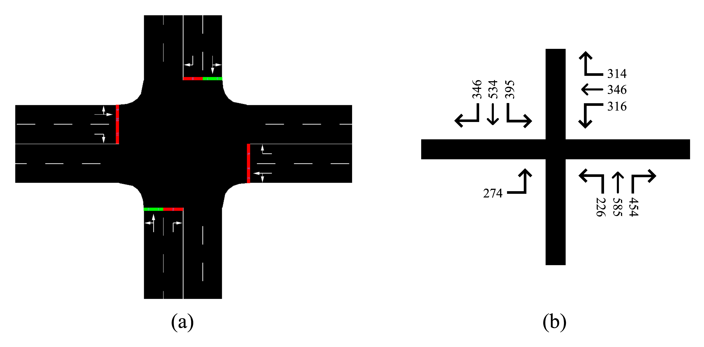

# Tigerpass: a heterogeneous-traffic intersection for SUMO and reinforcement learning

A ready-to-use SUMO scenario of the **Tigerpass intersection in Chattogram, Bangladesh**, packaged for traffic signal control research with [sumo-rl](https://github.com/LucasAlegre/sumo-rl) (Gymnasium and PettingZoo).

Most public signal-control benchmarks contain only cars, buses and trucks. Tigerpass carries **nine vehicle classes**, including rickshaws, CNG auto-rickshaws, tempos and human haulers, so you can test how controllers behave in the mixed, non-lane-based traffic common in South Asian cities.

<p align="center"></p>

## Install

```bash
pip install git+https://github.com/syeda-tamzida/tigerpass-mixed-traffic
```

SUMO is installed automatically through the `eclipse-sumo` package. Set `SUMO_HOME` once:

```bash
export SUMO_HOME=$(python -c "import sumo; print(sumo.SUMO_HOME)")
```

## Quick start

```python
import tigerpass_traffic as tp

env = tp.make_env(num_seconds=3600)          # Gymnasium environment
obs, info = env.reset(seed=0)
obs, reward, terminated, truncated, info = env.step(env.action_space.sample())
```

- `tp.make_parallel_env()` returns a PettingZoo environment for multi-agent methods.
- Any `sumo_rl.SumoEnvironment` argument can be passed, e.g. `tp.make_env(use_gui=True)` to watch the simulation.
- `tp.scenario_files()` returns the raw `.net.xml`, `.rou.xml` and `.sumocfg` paths if you want to use SUMO directly.

## Traffic composition

| Vehicle class | Share | | Vehicle class | Share |
|---|---|---|---|---|
| Car | 26% | | Human hauler | 7% |
| CNG auto-rickshaw | 22% | | Rickshaw | 6% |
| Motorcycle | 16% | | Truck | 5% |
| Bus | 11% | | Tempo | 4% |
| | | | Bicycle | 3% |

Ten turning movements with demand between 226 and 585 vehicles per hour (see `tp.DEMAND_VEH_PER_HOUR`). Each class has its own length, maximum speed and HBEFA emission class, so the scenario also supports emissions studies.

## Baselines (1 simulated hour, seed 0)

| Controller | Mean waiting time (s) | Mean queued vehicles | Mean speed (m/s) |
|---|---|---|---|
| Fixed-time (original plan) | 21.0 | 89.3 | 0.95 |
| Random phase selection | 20.8 | 96.0 | 1.00 |

Reproduce with `python examples/fixed_time_baseline.py`. A DQN training script is in `examples/train_dqn.py` (`pip install "tigerpass-traffic[train]"`).

## Research using this scenario

- Akter, S. T., Lamun, S. S. I., Ahmed, E., Sarkar, S., Roy, C. (2026). Machine Learning Based CO₂ Emission Prediction at an Urban Intersection under Heterogeneous Traffic Using SUMO Microsimulation. *IEEE QPAIN 2026*. [Paper](https://doi.org/10.1109/QPAIN69676.2026.11546352)
- Traffic Signal Control Optimization for Heterogeneous Traffic Using Reinforcement Learning (MPLight, IDQN vs. fixed time). Under review. [Code](https://github.com/syeda-tamzida/Traffic-Signal-Control-Optimization-for-Heterogeneous-Traffic-Using-Reinforcement-Learning)

## Citation

If you use this scenario, please cite it (see `CITATION.cff`, or use GitHub's "Cite this repository" button).

## License

MIT. The environment wrappers use [sumo-rl](https://github.com/LucasAlegre/sumo-rl) by Lucas N. Alegre.
